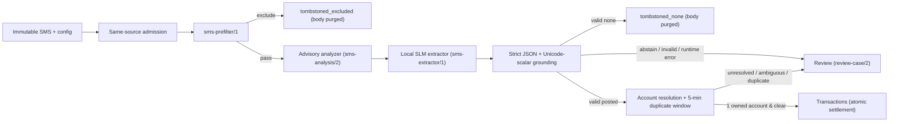

# Pocket Financer Intelligence

[](https://github.com/pocket-financer/pocket-financer-intelligence/actions/workflows/ci.yml)
[](https://www.python.org/)
[](configs/sms_processing/release-manifest.json)

`pocket-financer-intelligence` is the canonical owner of PocketFinancer's
platform-neutral SMS processing contracts, deterministic host pipeline, native
asset synchronization, evaluation harness, and local encrypted annotation
workbench.

On-device small language models (GGUF via `llama.cpp` on Android and Apple
Foundation Models on iOS) perform classification and direct grounded field
extraction. Deterministic host code owns same-source admission, fail-open
prefiltering, advisory structural analysis, strict JSON and Unicode-scalar span
validation, exact integer money normalization, account resolution, 5-minute
duplicate detection, persistence gating, and body-free tombstones.

## System overview



All active contracts, JSON schemas, prompts, GBNF grammar, runtime policy, and
SHA-256 bindings are published through
[configs/sms_processing/release-manifest.json](configs/sms_processing/release-manifest.json)
and synced cleanly into `pocket-financer-android` and `pocket-financer-ios` by
[scripts/sync_native_assets.py](scripts/sync_native_assets.py).

## Repository layout

```text
configs/sms_processing/
  release-manifest.json   Single SHA-256-bound release manifest for native apps
  prompts/                SLM extractor prompts (GGUF & Apple FM guided flat)
  grammars/               GBNF constraint grammar for direct JSON decoding
  profiles/               Currency, analyzer, validation, account, persistence & reason profiles
  schemas/                JSON Schemas for pipeline, extractor, trace, feedback, label, review
  evaluations/            Model-quality evaluation cohort & lane manifest
src/pocketfinancer_sms/   Active Python reference pipeline, corpus builder, evals, workbench
scripts/                  CLI entry points, native asset sync, repo safety & WSL setup
tests/                    Contract, prefilter, pipeline, evaluation, workbench & safety suites
DATA/                     Grandfathered 203-row regression fixture & legacy GGUF benchmark task
docs/                     Architecture, evaluation, workbench & WSL setup guides
```

Local and generated data directories are ignored by Git and enforced by
[scripts/check_repo_safety.py](scripts/check_repo_safety.py):

| Ignored path | Contents |
|---|---|
| `PRIVATE_DATA/` | Raw-derived corpus runs, SQLCipher workbench, backups, exports, local eval reports |
| `MODELS/` | Local `.gguf` and Hugging Face model assets |
| `RESULTS/` | Local benchmark and evaluation outputs |
| `TRAINING_ARTIFACTS/` | Future model-agnostic fine-tuning checkpoints and exports |
| `PUBLIC_CANDIDATE/` | Unreleased synthetic candidate artifacts |
| `UPSTREAM/` | Local external tool checkouts |
| `all_sms.json`, `*.db`, `*.csv` | Private local message exports and SQLite databases |

## Quickstart

### 1. Lightweight verification (CI parity)

From the WSL environment (`/home/tojinotzenin/pF_slm_selection/.venv/bin/python`
or a `requirements-ci.txt` virtual environment):

```bash
python scripts/check_repo_safety.py
python scripts/sync_native_assets.py --check --manifest-only
python -m ruff check .
python -m ruff check --select E4,E7,E9,F src scripts tests
python -m pytest -q
```

### 2. Sync native contract assets

```bash
# Regenerate release-manifest.json hashes after editing configs/sms_processing/
python scripts/sync_native_assets.py --manifest-only

# Sync clean contracts, prompts, grammar, profiles, and prefilter vectors to sibling repos
python scripts/sync_native_assets.py --target android
python scripts/sync_native_assets.py --target ios
python scripts/sync_native_assets.py --check
```

### 3. Local corpus, workbench, and evaluation

```bash
python scripts/run_sms_processing.py build-corpus
python scripts/run_sms_processing.py init-workbench
python scripts/run_sms_processing.py serve-workbench
python scripts/run_sms_processing.py backup-workbench
python scripts/run_sms_processing.py evaluate-extractor --gguf MODELS/<model>.gguf --suite synthetic --output-dir PRIVATE_DATA/sms_processing/evaluations/<run>
python scripts/run_sms_processing.py evaluate-apple-fm --suite synthetic --output-dir PRIVATE_DATA/sms_processing/evaluations/<run>
```

## Future fine-tuning direction

Legacy LFM2.5-specific training, LoRA probes, and candidate-selector sprawl have
been removed. Future model-agnostic fine-tuning will be built cleanly on top of
the SQLCipher workbench corpus using validated `CanonicalLabelV2` submissions
projected directly to `pocketfinancer.sms-extractor/1` targets via
`project_extractor_target(...)`, while preserving strict
template-component-disjoint pool separation.

## Privacy and evaluation rules

- Real personal SMS, senders, account identifiers, private per-row outputs, and
  model weights must stay local and ignored—never commit, print, log, or upload
  them to external services or APIs.
- All unit tests, docs, PR descriptions, and UI screenshots must use 100%
  invented/synthetic messages and identifiers.
- `DATA/extraction_ds.jsonl` is a grandfathered 203-row regression fixture only;
  never train on it or cite it as fresh production evidence.

## Documentation

- [Documentation map](docs/README.md)
- [Architecture](docs/ARCHITECTURE.md)
- [Evaluation guide](docs/EVALUATION.md)
- [Workbench guide](docs/WORKBENCH.md)
- [WSL and local setup](docs/WSL_AND_LOCAL_SETUP.md)
- [Agent and repository rules](AGENTS.md)
- [Contributing guide](CONTRIBUTING.md)
- [Scripts and CLI command map](scripts/README.md)
