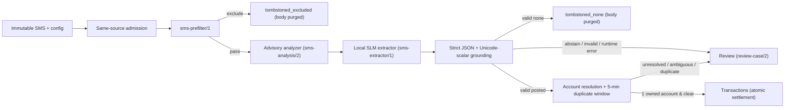

# Pocket Financer Intelligence

[](https://github.com/pocket-financer/pocket-financer-intelligence/actions/workflows/ci.yml)
[](https://www.python.org/)
[](configs/sms_processing/release-manifest.json)

`pocket-financer-intelligence` is the canonical owner of PocketFinancer's
platform-neutral SMS processing contracts, deterministic Python reference
pipeline, native asset synchronization, evaluation harness, and local encrypted
annotation workbench. Native mobile implementations live in
[pocket-financer-android](https://github.com/pocket-financer/pocket-financer-android)
and [pocket-financer-ios](https://github.com/pocket-financer/pocket-financer-ios).

On-device small language models (GGUF via `llama.cpp` on Android and Apple
Foundation Models on iOS) perform classification and direct grounded field
extraction. Deterministic host code owns same-source admission, fail-open
prefiltering, advisory structural analysis, strict JSON and Unicode-scalar span
validation, exact 64-bit integer money normalization, account resolution,
5-minute duplicate detection, persistence gating, and body-free tombstones.

## System overview



All active contracts, JSON schemas, prompts, GBNF grammar, runtime policy, and
SHA-256 bindings are published through
[configs/sms_processing/release-manifest.json](configs/sms_processing/release-manifest.json)
and synchronized into Android and iOS by
[scripts/sync_native_assets.py](scripts/sync_native_assets.py).

## Repository layout

```text
configs/sms_processing/
  release-manifest.json   SHA-256-bound release manifest for native apps
  prompts/                SLM extractor prompts (GGUF & Apple FM guided flat)
  grammars/               GBNF grammar for direct JSON decoding
  profiles/               Currency, analyzer, validation, account, persistence & reason profiles
  schemas/                JSON Schemas for pipeline, extractor, trace, feedback, label, review
  evaluations/            Model-quality evaluation cohort & lane manifest
src/pocketfinancer_sms/   Python reference pipeline, corpus builder, evaluators, workbench
scripts/                  CLI entry points, native asset sync, repo safety & WSL setup
tests/                    Contract, prefilter, analyzer, pipeline, eval, workbench & guard suites
DATA/                     Grandfathered 203-row regression fixture & legacy GGUF benchmark task
docs/                     Architecture, evaluation, workbench & WSL setup guides
```

Local and generated paths are ignored by Git and enforced by
[scripts/check_repo_safety.py](scripts/check_repo_safety.py):

| Ignored path | Contents |
|---|---|
| `PRIVATE_DATA/` | Raw-derived corpus runs, SQLCipher workbench, backups, exports, local eval reports |
| `MODELS/` | Local `.gguf` and Hugging Face model assets |
| `RESULTS/` | Local benchmark and evaluation outputs |
| `TRAINING_ARTIFACTS/` | Future model-agnostic fine-tuning checkpoints and exports |
| `PUBLIC_CANDIDATE/` | Unreleased synthetic candidate artifacts |
| `UPSTREAM/` | Local external tool checkouts |
| `all_sms.json`, `*.db`, `*.csv` | Private local message exports and SQLite databases |

## Quickstart

### 1. Lightweight verification (CI parity)

From a Python 3.11 environment with `requirements-ci.txt` (or the prepared WSL
environment described in [docs/WSL_AND_LOCAL_SETUP.md](docs/WSL_AND_LOCAL_SETUP.md)):

```bash
python scripts/check_repo_safety.py
python scripts/sync_native_assets.py --check --manifest-only
python -m ruff check .
python -m ruff check --select E4,E7,E9,F src scripts tests
shellcheck --external-sources --exclude=SC1090,SC1091,SC2086,SC2162,SC2317 -- $(git ls-files '*.sh')
python -m pytest -v
```

### 2. Synchronize native contract assets

```bash
# Regenerate release-manifest.json hashes after editing configs/sms_processing/
python scripts/sync_native_assets.py --manifest-only

# Sync contracts, prompts, grammar, profiles, and prefilter vectors to sibling repos
python scripts/sync_native_assets.py --target android
python scripts/sync_native_assets.py --target ios
python scripts/sync_native_assets.py --check
```

### 3. CLI command summary (`scripts/run_sms_processing.py`)

Every subcommand prints aggregate-safe JSON only and keeps private state under
ignored `PRIVATE_DATA/sms_processing/`.

| Subcommand | Purpose | Guide |
|---|---|---|
| `prefilter [--text "<sms>"]` | Run `sms-prefilter/1` on a string or stdin | [Architecture](docs/ARCHITECTURE.md) |
| `sync-native-assets [--manifest-only] [--check]` | Manifest build/verify wrapper | [Architecture](docs/ARCHITECTURE.md) |
| `build-corpus [--config <path>]` | Build or reuse the canonical corpus run | [Workbench](docs/WORKBENCH.md) |
| `migrate-secure-workbench` | Migrate plaintext `workbench.sqlite3` to SQLCipher `workbench-v2.sqlite3` | [Workbench](docs/WORKBENCH.md) |
| `init-workbench` | Import `CURRENT.json` manifest into encrypted `workbench-v2.sqlite3` | [Workbench](docs/WORKBENCH.md) |
| `serve-workbench [--port 8765]` | Serve the token-authenticated loopback UI (`127.0.0.1` only) | [Workbench](docs/WORKBENCH.md) |
| `backup-workbench` | Create and verify an encrypted SQLCipher backup + manifest | [Workbench](docs/WORKBENCH.md) |
| `export-workbench --selection-manifest <path> --consent-local-encrypted-export` | Export explicitly selected revisions as AES-256-GCM ciphertext | [Workbench](docs/WORKBENCH.md) |
| `import-native-trace --bundle <path> [--key-id native-trace-import-v1]` | Import an encrypted Android/iOS trace bundle (rejects blind pools) | [Workbench](docs/WORKBENCH.md) |
| `evaluate-extractor --gguf <path> --suite <suite> --output-dir <dir>` | Evaluate local GGUF via `llama-cpp-python` (`android_target_gguf`) | [Evaluation](docs/EVALUATION.md) |
| `evaluate-apple-fm --output-dir <dir> [--suite <suite>]` | Evaluate Apple Foundation Models on macOS (`apple_fm_python`) | [Evaluation](docs/EVALUATION.md) |

## Future fine-tuning direction

Future model-agnostic fine-tuning will build directly on the SQLCipher workbench
corpus using committed `CanonicalLabelV2` labels projected to
`pocketfinancer.sms-extractor/1` targets via `project_extractor_target(...)`,
preserving strict template-component-disjoint pool isolation.

## Privacy and evaluation rules

- Real personal SMS, senders, account identifiers, private per-row outputs, and
  model weights must stay local and ignored—never commit, print, log, or upload
  them to external services or APIs.
- All unit tests, golden vectors, docs, PR descriptions, and UI screenshots must
  use 100% invented synthetic data.
- `DATA/extraction_ds.jsonl` is a grandfathered 203-row regression fixture only;
  never train on it or cite it as a fresh test or production evidence.

## Documentation

- [Architecture](docs/ARCHITECTURE.md) — unified `sms-pipeline/1` stages, contracts, asset sync, status vocabulary, and planned fine-tuning
- [Evaluation guide](docs/EVALUATION.md) — GGUF, Apple FM, and stateful evaluation lanes, cohorts, metrics, and legacy benchmark runner
- [Workbench guide](docs/WORKBENCH.md) — canonical corpus builder, SQLCipher storage, loopback review UI, and encrypted exports
- [WSL and local setup](docs/WSL_AND_LOCAL_SETUP.md) — WSL Ubuntu `.venv`, native WSL2 `ext4` CUDA setup, CI parity, macOS Apple FM, and local archive utilities
- [Repository & agent instructions](AGENTS.md) — canonical rules for humans and coding agents
- [Contributing guide](CONTRIBUTING.md) — branch, testing, contract-sync, and PR workflow
