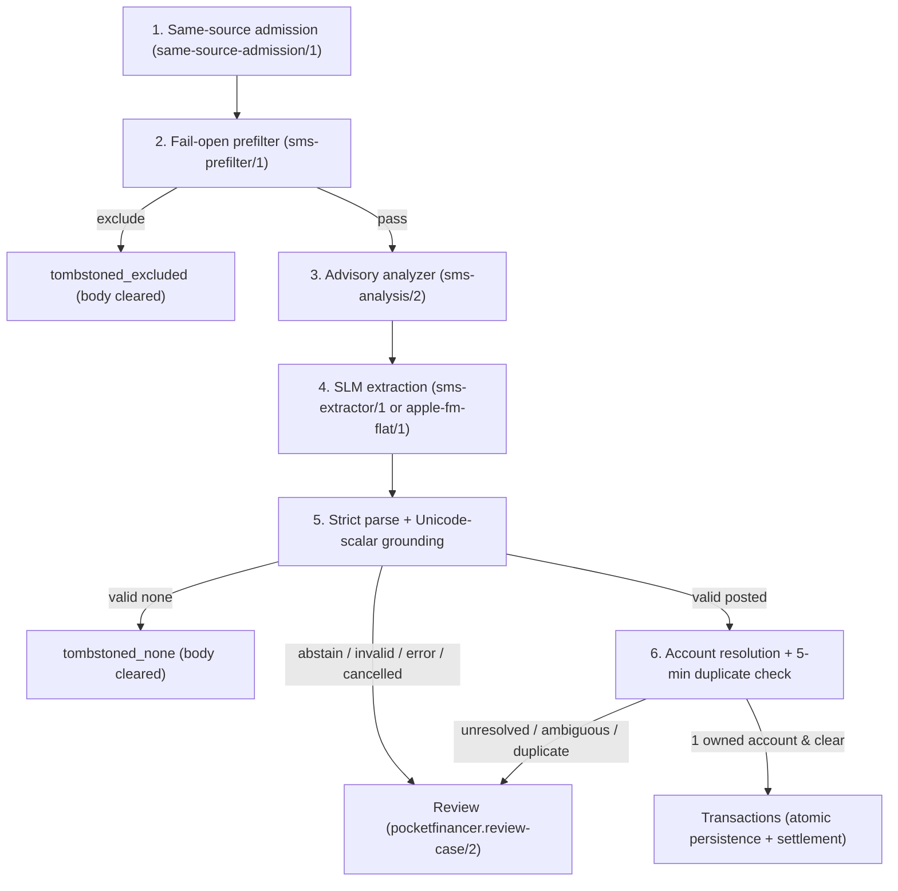

# Unified SMS Processing Architecture

PocketFinancer processes financial SMS on-device using a single unified contract
release (`pocketfinancer.sms-pipeline/1`) shared across Python, Android
(`llama.cpp` + GGUF), and iOS (`FoundationModels` guided generation).

The local small language model (SLM) performs semantic classification and
source-grounded extraction. Deterministic host code enforces admission,
prefiltering, strict JSON/Unicode-scalar validation, exact integer money
handling, account resolution, duplicate detection, persistence gating, and
body-free tombstones.

## End-to-end pipeline stages

### 1. Same-source admission (`src/pocketfinancer_sms/admission.py`)

Connector-scoped reliable source identity (`admission_action`) decides
before inference whether a message is `new`, `resume` (ready work resumes its
stored frozen configuration), `in_flight` (busy work never opens duplicate
Review or spawns a parallel model call), `reuse` (settled or interrupted work),
`conflict` (reliable identity changed evidence digest), or explicit `retry`
(creates a new child operation linked via `parent_operation_id`). Body hashes
are integrity checks only, never identities. Conformance vectors live in
[tests/sms_processing/golden/admission-v1.json](../tests/sms_processing/golden/admission-v1.json).

### 2. Deterministic fail-open prefilter (`src/pocketfinancer_sms/prefilter.py`)

`sms-prefilter/1` inspects only the immutable SMS body (never sender,
metadata, or model state) and excludes unambiguously non-transactional inputs
before model execution:

- `empty` — blank or whitespace-only text
- `no_digits` — no ASCII/Unicode decimal digit
- `gaming_promo` — fantasy/gaming promotional keywords
- `collect_or_mandate_request`, `otp_verification`, `telecom_notice` — gated
  against `_COMPLETED_GUARD` after stripping `_FUTURE_OR_CONDITIONAL` phrases
  (`once approved ...`, `will be debited`, etc.) so completed transactions
  mentioning OTP/collect phrases still pass to the SLM
- `brokerage_eod_report` — end-of-day brokerage balance/turnover statements
- `no_financial_cue` — no currency marker or financial keyword

Exclusions settle immediately as `tombstoned_excluded` with the raw SMS body
cleared (`body_retained=False`). Any uncertainty passes (`pass`, `eligible`).
All 54 cross-platform conformance vectors live in
[tests/sms_processing/golden/prefilter-vectors.json](../tests/sms_processing/golden/prefilter-vectors.json).

### 3. Advisory structural analyzer (`src/pocketfinancer_sms/analyzer.py`)

`DeterministicSmsAnalyzer` (`pocketfinancer.sms-analysis/2`, behavior
`pocketfinancer.structural-sms-analyzer/2`) uses configured profiles
(`core-en`, `india`, `currency`) to detect candidate amounts, directions,
accounts, counterparties, and risk cues (`failure`, `negation`, `pending`,
`due`, `request`, etc.). Output is strictly advisory (`advisory_evidence` in
`pocketfinancer.sms-extractor-input/1`)—never an allowlist or a validity gate.

### 4. Local SLM extraction (`configs/sms_processing/`)

Runtime policy (`release-manifest.json` & `profiles/extractor-validation.json`):

- Generation mode: `DIRECT_NON_THINKING`
- Decoding: `greedy` (temperature `0.0`)
- Answer token limit: `512`
- Raw output UTF-8 byte limit: `16,384`
- Parser deadline: `0` (no arbitrary wall-clock cutoff; cooperative cancellation
  fences late output)

Two wire transports share the exact same host semantic contract
`pocketfinancer.sms-extractor/1`:

- **GGUF / Android (`direct_json`)**: Uses embedded GGUF chat template,
  [prompts/sms-extractor.txt](../configs/sms_processing/prompts/sms-extractor.txt),
  optional [grammars/sms-extractor.gbnf](../configs/sms_processing/grammars/sms-extractor.gbnf),
  and strict JSON matching
  [schemas/sms-extractor.schema.json](../configs/sms_processing/schemas/sms-extractor.schema.json).
- **Apple Foundation Models / iOS (`apple_fm_guided_flat`)**: Uses
  [prompts/apple-fm-sms-extractor.txt](../configs/sms_processing/prompts/apple-fm-sms-extractor.txt)
  and the 18-field guided schema
  [schemas/apple-fm-flat.schema.json](../configs/sms_processing/schemas/apple-fm-flat.schema.json),
  projected without repair to `pocketfinancer.sms-extractor/1` via
  `project_apple_fm_flat_output(...)`.

### 5. Strict host parsing, grounding & exact money (`extractor.py`, `currency.py`)

`parse_and_normalize_extraction` rejects malformed JSON, duplicate keys at any
nesting depth, trailing content, markdown fences, NaN/Infinity constants, and
any unlisted fields (including model-invented `transaction_time`—host receipt
timestamp provenance must be `platform_received` or
`acquisition_supplied_message_time`).

For `decision == "posted"`, mandatory fields (`amount`, `direction`, `account`)
and optional `counterparty` must provide zero-based half-open **Unicode scalar**
`SourceSpan` evidence (`start_scalar`, `end_scalar`, `text`) matching the exact
immutable SMS substring:

- **Money**: `parse_money` uses isolated 64-digit `Decimal` precision to
  validate against `ISO_MINOR_UNITS` (`currency.json`) and signed 64-bit integer
  minor units (`MAX_SIGNED_64`), verifying exact agreement between `amount.value`
  and `amount.evidence.text`, plus currency grounding (`ISO_4217_CURRENT_CODES`
  and profile markers).
- **Direction**: `_direction_is_grounded` checks the normalized evidence span
  against explicit debit/credit lexical cues.
- **Account & counterparty**: `normalize_account_reference` extracts normalized
  VPA (`user@bank`) or a single 3–8 digit account/card suffix; `normalize_counterparty`
  applies NFKC + whitespace collapse + casefolding (<=256 chars).

Failed validations salvage independently grounded fields into `ReviewCase` via
`collect_grounded_extractor_fields` without ever promoting invalid output.

### 6. Account resolution, duplicate window & routing (`account_resolution.py`, `processing.py`)

- **Account resolution** (`pocketfinancer.account-resolution-profile/1`):
  `resolve_account` checks the local owned account catalog (`bank_account`,
  `card`, `vpa`). Exactly one match (`uniquely_resolved`) is required for
  automatic persistence; unresolved or ambiguous matches route to Review. Never
  creates accounts silently or falls back to a default account.
- **5-minute duplicate window** (`DUPLICATE_WINDOW_MS = 300_000`):
  `assess_duplicate` checks persisted `idempotency_key` / `source_event_key`
  (`already_persisted`), known transaction fingerprints, and
  `is_within_duplicate_window` matching `(account_id, direction, minor_units,
  currency)` within `+/-300,000 ms`, excluding the current `source_id` and
  `operation_id`. Opposite-direction reversals and different-account transfers do
  not collide.
- **Persistence routing** (`profiles/persistence-policy.json`):
  - Complete, valid, uniquely resolved, clear `posted` -> `transactions`
    (atomic with operation settlement)
  - Valid `none` -> `tombstoned_none` (raw SMS body purged, no review case)
  - Prefilter / invalid / outgoing exclusion -> `tombstoned_excluded` (raw SMS
    body purged)
  - `abstain`, validation failure, runtime error/truncation, interruption,
    unresolved/ambiguous account, or duplicate match -> `review`
    (`pocketfinancer.review-case/2`, append-only `pocketfinancer.user-feedback/3`,
    and hash-chained `pocketfinancer.processing-trace/3`).

## Cross-platform contract distribution

[scripts/sync_native_assets.py](../scripts/sync_native_assets.py) generates
[configs/sms_processing/release-manifest.json](../configs/sms_processing/release-manifest.json)
(versioning `release_id`, `duplicate_window_ms`, `routing_policy`,
`runtime_policy`, and per-artifact SHA-256 hashes over LF-normalized bytes) and
copies/verifies Android assets, iOS assets, and `prefilter-vectors.json`.

## Future model-agnostic fine-tuning architecture (Planned)

All legacy LFM2.5-specific fine-tuning, LoRA probing, and candidate-selector
code has been deleted. Any future fine-tuning pipeline will be built cleanly
from scratch as a model-agnostic module consuming committed annotations from
the local encrypted workbench:

1. **Source truth**: Human annotations stored under `pocketfinancer.canonical-label/2`
   (`CanonicalLabelV2` in `src/pocketfinancer_sms/labels.py`, schema
   `configs/sms_processing/schemas/canonical-label.schema.json`).
2. **Strict target projection**: Only `submitted` or `adjudicated` labels with
   `uncertain == False` and `operational_class != invalid_outgoing` pass
   `project_extractor_target(label, source)` (validated by
   `validate_canonical_label_v2`), producing clean
   `pocketfinancer.sms-extractor/1` JSON training targets without consulting
   analyzer candidates.
3. **Pool isolation**: Training and checkpoint selection consume
   `annotation_training` and `annotation_development` pools only, preserving
   strict template-component separation from `protected_test`,
   `later_time_holdout`, `legacy_review`, and `regression_only`
   (`DATA/extraction_ds.jsonl`).
4. **Model-agnostic training**: Chat templates, tokenizers, LoRA/QLoRA
   hyperparameters, and GGUF export/quantization targets live in declarative
   config and evaluate through `evaluate-extractor` / `evaluate-apple-fm`.
